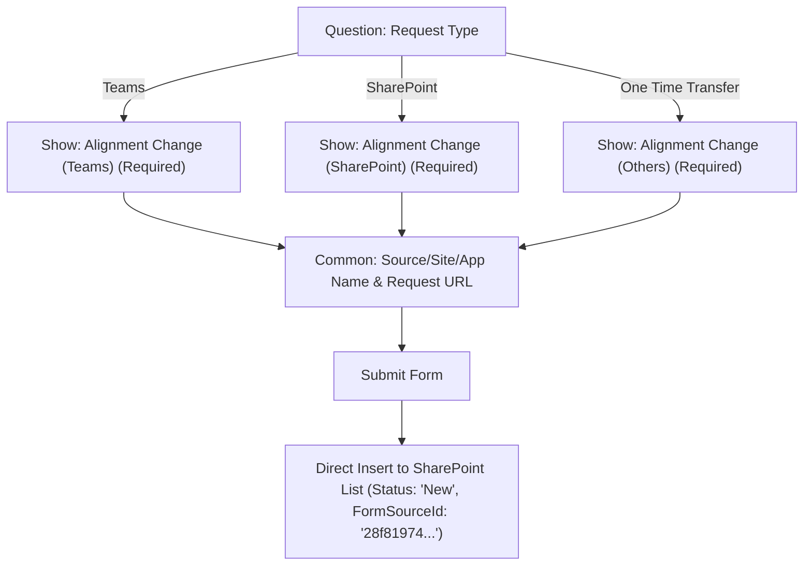
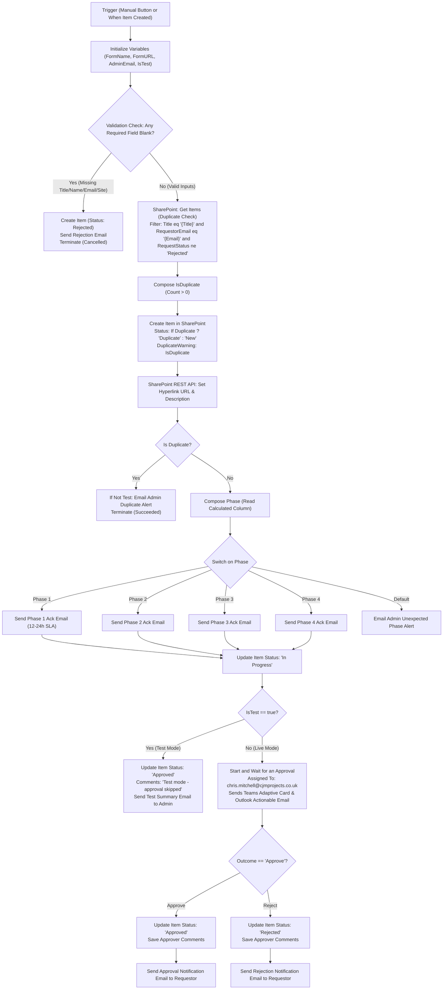

# Process Approval System — Architecture & Re-use Specification

This document provides a complete, reusable reference for the **Process Approval** system implemented across **SharePoint Online**, **Microsoft Lists Forms**, and **Power Automate**.

---

## 1. SharePoint List Schema

* **Site Collection**: `https://cjmprojectsltd.sharepoint.com/sites/LexNet`
* **List Title**: `Process Approval`
* **Internal List Name**: `Process_x0020_ApprovalList`
* **List ID**: `551e1767-3a0d-4a9c-92c1-c673a72e6c11`
* **Description**: Tracks processes submitted for approval.

### 1.1 Complete Column Reference

| Display Name | Internal / Static Name | Type | Required | Choices / Formula / Default | Purpose / Notes |
| :--- | :--- | :--- | :--- | :--- | :--- |
| **Request Title** | `Title` | Single line of text | **Yes** | — | Core title of the process request. |
| **Requestor Name** | `RequestorName` | Single line of text | No | — | Full name of the person submitting the request. |
| **Requestor Email** | `RequestorEmail` | Single line of text | No | — | Email address used for all status & outcome notifications. |
| **Date Requested** | `DateRequested` | Date and Time | No | Format: Date Only | Date the request was submitted. |
| **Requestor Business Unit** | `RequestorBusinessUnit` | Choice | No | `AUK`<br>`AUM`<br>`AAM` | Business division originating the request. |
| **Status** | `RequestStatus` | Choice | No | `New`<br>`In Progress`<br>`Rejected`<br>`Approved`<br>`Duplicate` | Primary state machine status of the workflow. |
| **Request Type** | `RequestType` | Choice | **Yes** | `Teams`<br>`SharePoint`<br>`One Time Transfer` | Category determining conditional alignment branching. |
| **Alignment Change (Teams)** | `AlignmentChangeTeams` | Choice | No | `NewCo to Open`<br>`RemainCo to Open`<br>`Open to RemainCo/NewCo` | Branched choice for Teams requests. Optional in list schema. |
| **Alignment Change (SharePoint)** | `AlignmentChangeSharePoint` | Choice | No | `RemainCo to NewCo`<br>`NewCo to RemainCo`<br>`RemainCo to Open`<br>`NewCo to Open` | Branched choice for SharePoint requests. Optional in list schema. |
| **Alignment Change (Others)** | `AlignmentChangeOthers` | Choice | No | `RemainCo to NewCo`<br>`NewCo to RemainCo`<br>`RemainCo to Open`<br>`NewCo to Open` | Branched choice for other transfer types. Optional in list schema. |
| **Source/Site/App Name** | `SourceSiteAppName` | Single line of text | No | — | Name of target site, application, or system to align. |
| **Phase** | `Phase` | Calculated (Text) | No | Formula (see Section 1.2) | Auto-calculated phase based on item creation date. |
| **URL** | `RequestURL` | Hyperlink or Picture | No | Format: Hyperlink | URL to the relevant site, document library, or app. |
| **Approver Comments** | `ApproverComments` | Multiple lines of text | No | Plain text | Feedback or rejection reasons from the approver. |
| **Duplicate Warning** | `DuplicateWarning` | Yes/No (Boolean) | No | Default: `No` | Flagged `true` if an active duplicate request is detected. |
| **Test** | `IsTest` | Yes/No (Boolean) | No | Default: `No` | When `true`, bypasses live human approval and emails. |
| **Form Name** | `FormName` | Single line of text | No | — | Name of originating form (`Request Approval Process`). |
| **Form URL** | `FormURL` | Hyperlink or Picture | No | Format: Hyperlink | Link to the submission form for resubmissions. |
| **Created Via** | `_FormSourceId_0` | Single line of text | No | Hidden / System | Auto-populated by Microsoft Lists with the Form ID. |

### 1.2 Phase Calculation Formula

The `Phase` column is a SharePoint Calculated Column that evaluates the item's `Created` timestamp against calendar milestones:

```excel
=IF(Created<DATE(2026,11,1),"Phase 1",IF(Created<DATE(2026,11,30),"Phase 2",IF(Created<DATE(2027,1,5),"Phase 3","Phase 4")))
```

* **Phase 1**: Prior to November 1, 2026
* **Phase 2**: November 1, 2026 – November 29, 2026
* **Phase 3**: November 30, 2026 – January 4, 2027
* **Phase 4**: January 5, 2027 onward

---

## 2. Microsoft Lists Form Integration

* **Form Name**: `Request Approval Process`
* **Form ID**: `28f81974-4157-476c-8b86-9e60491dfe57`
* **Sharing Link**: `https://cjmprojectsltd.sharepoint.com/:l:/s/LexNet/JABnFx5VDTqcSpLBxnOnLmwRAfUpShNHU48ayB98T7RMcMk?nav=MjhmODE5NzQtNDE1Ny00NzZjLThiODYtOWU2MDQ5MWRmZTU3`

### 2.1 Branching Logic Configuration
In Microsoft Lists Forms, questions inherit directly from list columns. Configure the form rules as follows:



> [!NOTE]
> Setting each branched question to **Required** in Microsoft Forms only enforces the rule if the user is routed to that question. Questions skipped by branching are submitted as empty, which the list schema and Power Automate handle cleanly.

---

## 3. Power Automate Workflow Architecture

* **Flow Name**: `Process Approval - TEST (manual trigger)`
* **Flow ID**: `2f08f0e2-320b-4997-bcb9-0fd6ff143344`
* **Environment**: `Default-36037c25-6fc1-4418-8edd-abbc98e96cbc`

### 3.1 End-to-End Workflow Diagram



---

## 4. Key Flow Logic & Expressions

### 4.1 Input Validation (`Validation_Check`)
Checks for non-empty text (trimming whitespace). Evaluates to `true` (failure) if any required core input is missing:
```json
{
  "or": [
    { "equals": [ "@empty(trim(coalesce(triggerBody()?['RequestTitle'], '')))", true ] },
    { "equals": [ "@empty(trim(coalesce(triggerBody()?['RequestorName'], '')))", true ] },
    { "equals": [ "@empty(trim(coalesce(triggerBody()?['RequestorEmail'], '')))", true ] },
    { "equals": [ "@empty(trim(coalesce(triggerBody()?['SourceSiteAppName'], '')))", true ] }
  ]
}
```

### 4.2 Duplicate Detection
1. **OData Query Filter** (`Get_items_duplicate_check`):
   ```odata
   Title eq '@{triggerBody()?['RequestTitle']}' and RequestorEmail eq '@{triggerBody()?['RequestorEmail']}' and RequestStatus ne 'Rejected'
   ```
2. **Boolean Evaluation** (`Compose_IsDuplicate`):
   ```json
   @greater(length(body('Get_items_duplicate_check')?['value']), 0)
   ```

### 4.3 Safe Field Mapping (`Create_item`)
Handles optional/empty choice fields gracefully without generating invalid schema payloads:
```json
{
  "item/AlignmentChangeTeams/Value": "@if(empty(triggerBody()?['AlignmentChangeTeams']), null, triggerBody()?['AlignmentChangeTeams'])",
  "item/AlignmentChangeSharePoint/Value": "@if(empty(triggerBody()?['AlignmentChangeSharePoint']), null, triggerBody()?['AlignmentChangeSharePoint'])",
  "item/AlignmentChangeOthers/Value": "@if(empty(triggerBody()?['AlignmentChangeOthers']), null, triggerBody()?['AlignmentChangeOthers'])"
}
```

### 4.4 Approver Comments Coalescing
Extracts comments from the first responder, falling back to empty string if none provided:
```json
@{coalesce(first(body('Start_and_wait_for_an_approval')?['responses'])?['comments'], '')}
```

---

## 5. Notification Email Templates

### 5.1 Approval Confirmation (`Email_requestor_Approved`)
* **Recipient**: `@triggerBody()?['RequestorEmail']`
* **Subject**: `Approved: @{triggerBody()?['RequestTitle']}`
* **Importance**: `Normal`
* **HTML Body**:
```html
<p>Hello @{triggerBody()?['RequestorName']},</p>
<p>Your Process Approval request for <b>@{triggerBody()?['SourceSiteAppName']}</b> has been <b style="color: green;">APPROVED</b>.</p>
<p><b>Request Details:</b></p>
<ul>
  <li><b>Request Title:</b> @{triggerBody()?['RequestTitle']}</li>
  <li><b>Request ID:</b> #@{body('Create_item')?['ID']}</li>
  <li><b>Phase:</b> @{outputs('Compose_Phase')}</li>
  <li><b>Business Unit:</b> @{triggerBody()?['RequestorBusinessUnit']}</li>
  <li><b>Request Type:</b> @{triggerBody()?['RequestType']}</li>
  <li><b>Approver:</b> @{coalesce(first(body('Start_and_wait_for_an_approval')?['responses'])?['responder']?['displayName'], 'Approver')}</li>
  <li><b>Approver Comments:</b> @{if(empty(coalesce(first(body('Start_and_wait_for_an_approval')?['responses'])?['comments'], '')), 'None provided', coalesce(first(body('Start_and_wait_for_an_approval')?['responses'])?['comments'], ''))}</li>
</ul>
<p>You can view the request record in SharePoint: <a href="@{body('Create_item')?['{Link}']}">View Request #@{body('Create_item')?['ID']}</a></p>
<p>Kind regards,<br>Process Approval Team</p>
```

### 5.2 Rejection Notification (`Email_requestor_Rejected`)
* **Recipient**: `@triggerBody()?['RequestorEmail']`
* **Subject**: `Rejected: @{triggerBody()?['RequestTitle']}`
* **Importance**: `High`
* **HTML Body**:
```html
<p>Hello @{triggerBody()?['RequestorName']},</p>
<p>Your Process Approval request for <b>@{triggerBody()?['SourceSiteAppName']}</b> has been <b style="color: red;">REJECTED</b>.</p>
<p><b>Request Details:</b></p>
<ul>
  <li><b>Request Title:</b> @{triggerBody()?['RequestTitle']}</li>
  <li><b>Request ID:</b> #@{body('Create_item')?['ID']}</li>
  <li><b>Phase:</b> @{outputs('Compose_Phase')}</li>
  <li><b>Approver:</b> @{coalesce(first(body('Start_and_wait_for_an_approval')?['responses'])?['responder']?['displayName'], 'Approver')}</li>
  <li><b>Reason / Comments:</b> @{if(empty(coalesce(first(body('Start_and_wait_for_an_approval')?['responses'])?['comments'], '')), 'No comments provided', coalesce(first(body('Start_and_wait_for_an_approval')?['responses'])?['comments'], ''))}</li>
</ul>
<p>You can review the request record in SharePoint: <a href="@{body('Create_item')?['{Link}']}">View Request #@{body('Create_item')?['ID']}</a></p>
<p>If you have questions regarding this decision, please contact the approver or your department lead.</p>
<p>Kind regards,<br>Process Approval Team</p>
```

---

## 6. How to Re-use This Solution

### 6.1 Creating a New Target List
1. Create a custom SharePoint list named `Process Approval`.
2. Add the custom columns defined in [Section 1.1](#11-complete-column-reference).
3. Create the calculated column `Phase` with the formula from [Section 1.2](#12-phase-calculation-formula).
4. In the list ribbon, click **Forms** ➔ **New form** to create your intake form and apply the branching rules from [Section 2.1](#21-branching-logic-configuration).

### 6.2 Switching to Automated Production Trigger
In the production version of the Power Automate flow, replace the manual button trigger (`Request-Button`) with:
* **Trigger**: SharePoint – `When an item is created`
  * **Site Address**: `https://cjmprojectsltd.sharepoint.com/sites/LexNet`
  * **List Name**: `Process Approval`
* **Trigger Conditions** (in Trigger Settings):
  ```
  @equals(triggerOutputs()?['body/OData__FormSourceId_0'], '28f81974-4157-476c-8b86-9e60491dfe57')
  ```
  *(Or check `@equals(triggerOutputs()?['body/RequestStatus/Value'], 'New')`)*
* **Benefit**: Because submissions through the Microsoft Lists form write directly into SharePoint, the flow triggers instantly with the item already created, skipping manual data entry and executing validation, phase notifications, and human approval seamlessly.
